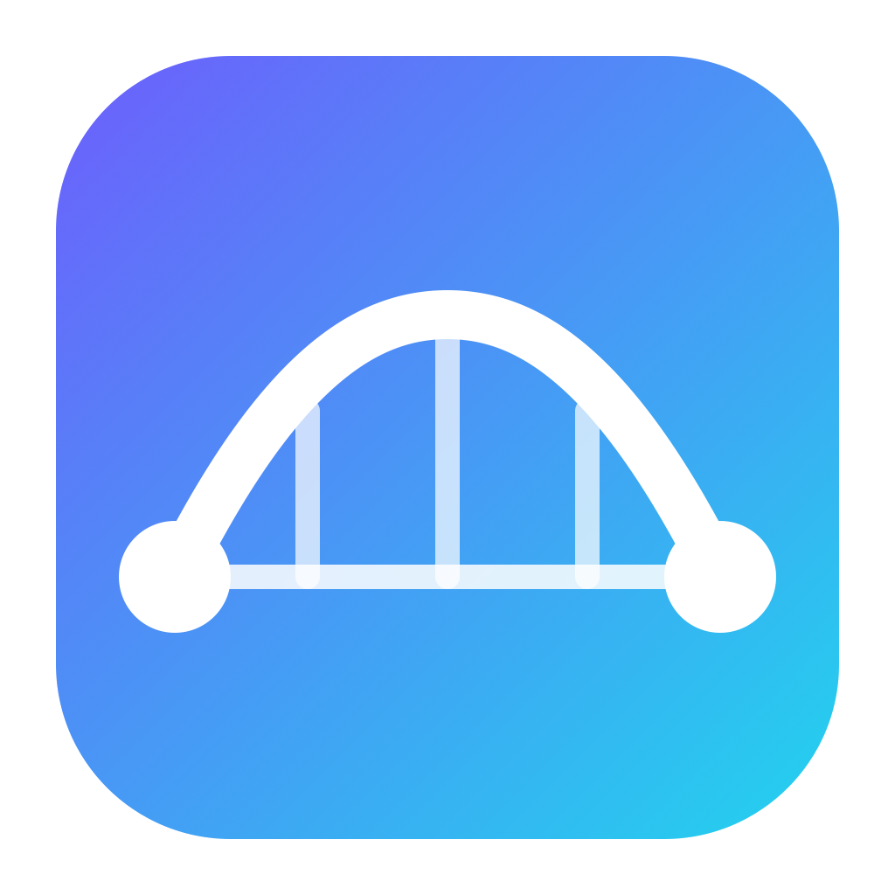

<p align="center">
  
</p>

<h1 align="center">DAFO Agent Bridge for VS Code</h1>

<p align="center">
  <b>Let your GitHub Copilot agents talk to each other — across VS Code windows, apps and machines.</b>
</p>

<p align="center">
  <a href="https://gabgiani.github.io/DAFO-Agent-Bridge-for-VSCode/">Website</a> ·
  <a href="https://github.com/gabgiani/DAFO-Agent-Bridge-for-VSCode/releases/latest">Download</a> ·
  <a href="#install">Install</a> ·
  <a href="#unattended-mode">Unattended mode</a> ·
  <a href="#security">Security</a>
</p>

---

DAFO Agent Bridge connects Copilot agents running in different VS Code windows. One agent asks another app a question — with logs and context — and that app's agent solves it **in its own codebase** and sends the answer back. You approve every request, or let a window run unattended.

```
web-frontend (Copilot)                     billing-api (Copilot)
  "Ask billing-api why POST /invoices
   returns 500 and send them this log"
        │ bridge_send_request ─────────►  🔔 Request from web-frontend
        │                                    [Accept] [View] [Reject]
        │                                  agent investigates and fixes
        ◄──────────────── bridge_send_reply
  "billing-api: fixed a null customer
   check; now returns 422"
```

## How it works

- A small **Rust node** runs on one Mac. It stores the message history and routes requests over **HTTPS**.
- Every VS Code window with the **extension** connects to the node under an **app name** (e.g. `billing-api`).
- The extension registers an **MCP server**, so Copilot Chat gets the Agent Bridge tools without editing any config.
- Incoming requests appear as notifications with **Accept / View / Reject**. Accepting one opens a new agent-mode chat with the request.
- Each machine links to the node with **its own token**, created on the node dashboard and revocable at any time.

| Copilot tool | What it does |
|---|---|
| `bridge_list_apps` | Lists the apps (VS Code windows) connected right now |
| `bridge_send_request` | Sends a request with subject and full context to another app |
| `bridge_wait_for_reply` | Waits for the reply, a rejection or a timeout |
| `bridge_send_reply` | Answers a request received from another app |
| `bridge_list_messages` | Lists recent messages sent or received by this app |
| `bridge_get_message` | Gets a full message by id |
| `bridge_cancel_request` | Withdraws a request this app sent that is not answered yet |

## MCP endpoint for other AI apps

The node itself is an MCP server over Streamable HTTP, so any MCP client (for example the **DAFO Swarm** chat) can talk to your VS Code apps without the extension:

| Setting | Value |
|---|---|
| URL | `https://<node address>/mcp?app=<name>`, where `<name>` is how the client appears to VS Code apps, e.g. `swarm` |
| Authorization token | A machine token created in the node dashboard (sent as `Bearer`) |
| Certificate | Self-signed. The token carries its SHA-256 fingerprint (`abd1.` + base64url of the 32-byte secret followed by the 32-byte fingerprint), so DAFO Swarm pins it automatically. Other clients can pin the fingerprint shown in the node dashboard. |

**Background tasks.** Clients that declare the MCP tasks extension (`io.modelcontextprotocol/tasks`, SEP-2663) get `bridge_send_request` as a task:

- the call returns at once with a task id and a short "received and queued" text for the model;
- `tasks/get` reports `working` ("waiting for billing-api to accept", then "accepted, working on it"), and finally `completed` with the reply, or a rejection marked as an error;
- `tasks/cancel` withdraws the request, and VS Code is told it is no longer needed.

Tasks belong to the app that created them, and the server suggests polling every 5 s. Clients without the extension get the same tools as the VS Code MCP server, including `bridge_wait_for_reply`.

## Install

### 1. Install the node on one Mac

1. Download **[DAFO-Agent-Bridge-macOS.dmg](https://github.com/gabgiani/DAFO-Agent-Bridge-for-VSCode/releases/latest/download/DAFO-Agent-Bridge-macOS.dmg)** and open it.
2. Drag **DAFO Agent Bridge** to **Applications**, then open it.
3. Click **Install** and confirm the ports. The suggested values are `7878` for other machines and `7879` for the local dashboard.
4. The node runs in the background, starts again at every login, and opens its dashboard.

**Menu bar icon.** A ⇄ icon in the menu bar shows whether the node is running and which VS Code apps are connected. Its menu has **Open Dashboard**, **Show Log** and **Restart Node**. The icon appears dimmed when the node is not responding. **Hide Menu Bar Icon** only removes the icon; the node keeps running. The icon comes back at the next login, or when you open the app again.

Open the app again at any time to reach the dashboard or to uninstall the node. If macOS asks whether to accept incoming connections, choose **Allow**.

### 2. Create a token for each machine

In the dashboard (`http://127.0.0.1:7879`), enter a machine name and click **Create token**. Copy the token; it is shown only once. The dashboard also lists the **node addresses** (IP:port) other machines should use. The node's own Mac is linked automatically.

### 3. Install the VS Code extension

Download **[dafo-agent-bridge-vscode.vsix](https://github.com/gabgiani/DAFO-Agent-Bridge-for-VSCode/releases/latest/download/dafo-agent-bridge-vscode.vsix)** and in VS Code open **Extensions → ⋯ → Install from VSIX…**, or run:

```sh
code --install-extension dafo-agent-bridge-vscode.vsix
```

The extension already includes the Agent Bridge binary for macOS (Apple Silicon and Intel), Windows x64 and Linux (x64 and arm64). That includes Remote-SSH, WSL and dev containers, where the extension runs on the remote Linux host.

### 4. Link and name each window

1. Click **Agent Bridge: Link** in the status bar.
2. Enter the node address (e.g. `10.8.0.5:7878`) and paste the token.
3. Name the app for this workspace. The folder name is suggested.
4. When Copilot asks to trust the **DAFO Agent Bridge** MCP server, allow it.

### 5. Ask another app

In Copilot Chat (agent mode):

```
Ask billing-api how invoices are validated before they are stored, and wait for the answer.
```

## Unattended mode

Run **Agent Bridge: Toggle Auto-Accept** in a workspace. Incoming requests are accepted automatically, opened in a new agent-mode chat and processed **one at a time**. The status bar shows a robot icon while this mode is on.

| Setting | Default | Description |
|---|---|---|
| `agentBridge.autoAccept` | `false` | Turns unattended mode on |
| `agentBridge.autoAcceptFrom` | `["*"]` | Apps that are auto-accepted (`*` = any linked app) |
| `agentBridge.autoAcceptTimeoutMinutes` | `30` | How long to wait for a reply before moving on to the next request |

VS Code still asks before the chat runs tools such as editing files, running commands and `bridge_send_reply`. To run hands-free, approve them with **Always Allow** or configure auto-approval (search for `autoApprove` in Settings).

> **Warning:** In unattended mode, text written by another agent drives an agent that can modify this workspace. Only enable it between apps you trust, and restrict `autoAcceptFrom`.

## Security

- **Encrypted transport:** HTTPS with a self-signed certificate created when the node is installed. Clients pin its SHA-256 fingerprint, which is embedded in each machine token.
- **Per-machine tokens:** 256-bit random secrets. The node stores only their hash. Revoking a machine rejects its requests and closes its open streams.
- **Local-only dashboard:** it listens on `127.0.0.1` and rejects foreign `Host` headers and cross-site requests.
- **Human in the loop:** every request needs an explicit Accept unless unattended mode is turned on.
- **Bounded input:** app names, subjects and bodies are validated, and each message is limited to 512 KB.
- **Signed and notarized:** the app, the CLI and the binary bundled in the extension are signed with a Developer ID and notarized by Apple.

## Command line

The same binary is a full CLI. It is included in the app at `/Applications/DAFO Agent Bridge.app/Contents/MacOS/agent-bridge`, and also available as [agent-bridge-macos-universal.zip](https://github.com/gabgiani/DAFO-Agent-Bridge-for-VSCode/releases/latest/download/agent-bridge-macos-universal.zip), [agent-bridge-linux-x64.tar.gz](https://github.com/gabgiani/DAFO-Agent-Bridge-for-VSCode/releases/latest/download/agent-bridge-linux-x64.tar.gz), [agent-bridge-linux-arm64.tar.gz](https://github.com/gabgiani/DAFO-Agent-Bridge-for-VSCode/releases/latest/download/agent-bridge-linux-arm64.tar.gz) and [agent-bridge-windows-x64.zip](https://github.com/gabgiani/DAFO-Agent-Bridge-for-VSCode/releases/latest/download/agent-bridge-windows-x64.zip). The Linux builds are static and need no dependencies; the Windows build is not code-signed yet, so SmartScreen may warn. On Linux and Windows, `install`/`uninstall`/`dashboard` are not available; run the node with `init` and `serve`.

```sh
# Node
agent-bridge install --port 7878 --admin-port 7879   # install as a login service
agent-bridge device add "Build server"               # create a machine token
agent-bridge device list
agent-bridge device revoke <id>
agent-bridge dashboard
agent-bridge uninstall [--purge]

# Any machine
agent-bridge pair --address 10.8.0.5:7878            # token read from stdin
agent-bridge client-status

# Used by the extension
agent-bridge mcp --app billing-api
agent-bridge watch --app billing-api

# Foreground node
agent-bridge init --bind 0.0.0.0:7878 --admin-bind 127.0.0.1:7879
agent-bridge serve
```

Configuration and data are stored in `~/Library/Application Support/agent-bridge` (override with `--home` or `AGENT_BRIDGE_HOME`). Node logs are in `~/Library/Logs/agent-bridge.log`.

## Requirements

- **Node:** macOS 12 or later, on Apple Silicon or Intel.
- **Extension:** VS Code 1.101 or later with GitHub Copilot Chat (agent mode). It runs on macOS, Windows x64 and Linux x64/arm64, locally or through Remote-SSH, WSL or dev containers.
- **Network:** every linked machine must be able to reach the node's IP and port (LAN or VPN).

## Roadmap

- **DAFO Swarm integration, phase 1 (implemented):** the node exposes MCP over HTTPS with background tasks. DAFO Swarm registers it as an MCP server with background tasks on. Its chat gets an immediate "queued" answer, polls the task, and posts the reply with a notification bell in the same conversation that asked.
- **DAFO Swarm integration, phase 2:** VS Code agents ask Swarm, which answers from its knowledge base about the user's ideas and decisions.
- **Later:** automatic continuation when a reply arrives, multi-message threads between apps, attachments, and progress updates from the answering agent.

## License

DAFO Agent Bridge is free to use and distributed in binary form only; the source code is not public. See [LICENSE.md](LICENSE.md). Questions and bug reports: [issues](https://github.com/gabgiani/DAFO-Agent-Bridge-for-VSCode/issues).
